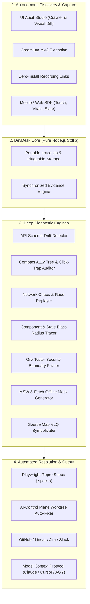

# TraceDeck / DevDesk — Complete User & Superpowers Guide

> **Transforming visual bug recordings into deterministic reproduction specs, autonomous audits, and AI-driven fixes.**

---

## 1. Why Use DevDesk?

Traditional debugging is fragmented, slow, and expensive:

| Traditional Workflow | DevDesk / TraceDeck Solution |
| :--- | :--- |
| **"Cannot Reproduce" / "Works on my machine"**: Engineers spend 60–70% of time guessing what the user did. | **Deterministic Evidence Bundle**: Synchronized video, console logs, network events, DOM mutations, environment info, and W3C distributed tracing in one portable file (`.trace.zip`). |
| **Bloated Cloud APM Subscriptions**: Sentry or LogRocket charge per event and send proprietary data to third-party clouds. | **Zero Runtime Dependencies & 100% Self-Hosted**: Runs entirely on the Node.js standard library. No telemetry tracking, no external cloud storage required, total privacy. |
| **Manual Test Writing**: Developers spend hours converting a reported bug into an automated Playwright test. | **Instant Playwright & Chaos Spec Generation**: One click exports executable Playwright tests, network mocks (MSW/Fetch), and race-condition chaos replays. |
| **LLM Token Inefficiency**: Feeding raw HTML (50k–200k tokens) and multi-megabyte log files to AI assistants wastes context and costs money. | **Token-Optimized Diagnostics**: Compact A11y trees (>90% token reduction), high-signal causal chains (Action → Network → Exception), and component blast-radius tracking. |
| **Reactive Bug Fixing**: Teams only find out about broken pages when angry users complain or churn. | **Autonomous Proactive UI Audit Studio**: Built-in crawler inventories controls, checks HTTP status codes, computes zero-dep visual PNG diffs, and auto-files bug captures. |

---

## 2. Core Superpowers Overview



---

## 3. How to Use It: Step-by-Step

### 3.1 Quick Start
```bash
# Start the TraceDeck server
npm start
# Server listens on http://localhost:4177
# Web Dashboard: http://localhost:4177/app/
```

Default project key for local development: `td_local_dev`.

---

### 3.2 Web Dashboard Interface

Navigate to `http://localhost:4177/app/`:

1. **Captures Tab**:
   - **Left Pane**: List of recorded captures with error indicators, source badges, and timestamps.
   - **Video & Canvas Player**: Video playback synchronized with millisecond markers on the scrubber.
   - **Timeline Scrubber**: Click any event marker to seek video and highlight the exact console/network event.
   - **Tab Bar**: Switch between `All`, `Console`, `Network`, `Actions`, `DOM`, `Errors`, `Environment`, `App Data`, and `AI Analysis`.

2. **Action Toolbar (Superpower Actions)**:
   - **`⚡ Auto-Fix (AI)`**: Packages the causal chain into an AI-Control capsule and provisions an isolated Git branch (`fix/td-<id>`).
   - **`Reproduction check`**: Live backend health checks on captured failing endpoints; generates verified Playwright specs.
   - **`Schema Drift`**: Infers JSON schemas from API traffic and highlights contract discrepancies or missing properties.
   - **`A11y & Traps`**: Audits accessibility structure and alerts on invisible click-jackers or overlay interceptors.
   - **`Chaos Repro`**: Downloads `<id>.chaos.spec.ts` with latency jitter and rapid burst clicks.
   - **`Lineage`**: Displays root-cause diagnosis linking user interaction to UI component, state mutations, and network errors.
   - **`Security probe`**: Runs non-destructive checks for reflected XSS, CORS misconfigurations, and open redirects.
   - **`Offline mocks`**: Downloads Mock Service Worker (`handlers.js`) to reproduce network traffic offline.
   - **`Playwright spec`**: Direct download of standard Playwright reproduction script.
   - **`Export .trace`**: Portable zip containing all video, logs, and metadata for offline sharing.

3. **UI Audits Tab**:
   - Click **`+ New audit`**. Enter target URL and route crawl limit (e.g. `https://my-app.test`, max 15).
   - TraceDeck crawls pages, inventories buttons and links, checks status codes, and automatically logs captures for any 500s or exceptions.

---

### 3.3 Command-Line Interface (CLI)

The CLI allows developers and CI/CD pipelines to interact with TraceDeck directly from the terminal:

```bash
# Health check
node tools/cli/tracedeck.mjs health

# List captures
node tools/cli/tracedeck.mjs list

# Inspect capture details
node tools/cli/tracedeck.mjs inspect <captureId>

# Triage root cause & causal chain
node tools/cli/tracedeck.mjs triage <captureId>

# Detect API Schema Drift (Contract Violations)
node tools/cli/tracedeck.mjs drift <captureId> [--contract expected_schema.json]

# Extract compact Accessibility Tree & Click-Traps (Token-efficient)
node tools/cli/tracedeck.mjs a11y <captureId> [--html snapshot.html]

# Generate Playwright Chaos Replay spec (tests race conditions & debounce)
node tools/cli/tracedeck.mjs chaos <captureId> [--out cart-chaos.spec.ts]

# Trace Component & State Blast-Radius
node tools/cli/tracedeck.mjs lineage <captureId>

# Run non-destructive security probes
node tools/cli/tracedeck.mjs probe <captureId>

# Export offline network mocks (MSW or Fetch)
node tools/cli/tracedeck.mjs mocks <captureId> --format msw --out handlers.js
node tools/cli/tracedeck.mjs mocks <captureId> --format fetch --out mocks.js

# Route capture to AI-Control Plane for automated worktree fix
node tools/cli/tracedeck.mjs autofix <captureId>

# Run autonomous UI audit crawl
node tools/cli/tracedeck.mjs audit https://my-app.test --max 20
node tools/cli/tracedeck.mjs audits

# Export portable .trace.zip bundle
node tools/cli/tracedeck.mjs export <captureId> --out issue-402.trace.zip

# Import portable .trace.zip bundle into server
node tools/cli/tracedeck.mjs import issue-402.trace.zip
```

---

### 3.4 Model Context Protocol (MCP) for AI Assistants

Connect Claude Code, Cursor, Windsurf, or Google Antigravity directly to DevDesk.

#### Configuration (`mcpServers` in configuration file):
```json
{
  "mcpServers": {
    "tracedeck": {
      "command": "node",
      "args": ["tools/mcp/server.mjs"],
      "env": {
        "TRACEDECK_URL": "http://localhost:4177",
        "TRACEDECK_KEY": "td_local_dev"
      }
    }
  }
}
```

#### Available MCP Tools for AI Agents:
- **`list_captures`**: Lists recent bug reports with counts and status.
- **`triage_capture`**: Returns high-signal causal chain (`Action -> Network -> Exception`) consuming <300 tokens.
- **`check_schema_drift`**: Detects API payload changes without reading server source code.
- **`get_a11y_tree`**: Analyzes DOM in condensed accessibility format (>90% token savings vs raw HTML).
- **`generate_chaos_repro`**: Returns runnable Playwright race-condition test.
- **`get_component_lineage`**: Provides component root-cause and state mutation diagnosis.
- **`run_security_probe`**: Executes non-destructive boundary and CORS checks.
- **`export_mocks`**: Generates offline mock handlers.
- **`auto_fix_capture`**: Creates an isolated worktree branch and task capsule.
- **`start_audit` / `list_audits`**: Launches background UI crawls.

---

### 3.5 Browser SDK Integration

Add the script tag to your web app:
```html
<script src="http://localhost:4177/sdk/tracedeck.js"></script>
<script>
  TraceDeck.init({
    serverUrl: 'http://localhost:4177',
    projectKey: 'td_local_dev',
    maskInputs: true,
    recordConsole: true,
    recordNetwork: true
  });

  // Track state snapshots (Redux / Zustand / Pinia)
  TraceDeck.recordState('cart', { items: 3, total: 45.99 });

  // Record active feature flags
  TraceDeck.setFeatureFlags({ 'new-checkout-flow': true, 'promo-v2': false });
</script>
```

---

## 4. Real-World Use Cases

### Use Case 1: Silent Frontend Crash Caused by API Contract Drift
- **Problem**: Backend API changed a field: `authorId` is now `null` instead of a string, and `discount` was removed. The web page renders completely blank with: `TypeError: Cannot read properties of null`.
- **How DevDesk Solves It**:
  1. Capture is recorded.
  2. Run `tracedeck drift <captureId>`.
  3. DevDesk infers the schema from live network traffic and compares it to expected contract schemas.
  4. Returns instant diagnosis: `missing_required_property: discount` and `type_mismatch: metadata.authorId (expected string, got null)`.
  5. Developer or AI agent fixes the null-safety check in seconds without guessing.

---

### Use Case 2: Flaky UI Button & Invisible "Click Trap"
- **Problem**: Users report clicking "Place Order" does nothing. The button isn't disabled, and no console error appears.
- **How DevDesk Solves It**:
  1. Capture contains the page DOM.
  2. Click **`A11y & Traps`** in dashboard or call `get_a11y_tree`.
  3. DevDesk condenses the 150KB DOM down to ~70 tokens, immediately flagging:
     `invisible_click_interceptor: Element <div style="position:fixed; z-index:9999; opacity:0; pointer-events:auto"> overlays checkout button`.
  4. Root cause discovered: A tracking modal backdrop remained active after being closed.

---

### Use Case 3: Race Conditions & Flaky Cart Updates
- **Problem**: Rapid double-clicking on "Add to Cart" sometimes results in an incorrect quantity or charges the user twice due to out-of-order network responses.
- **How DevDesk Solves It**:
  1. Open capture in DevDesk and click **`Chaos Repro`**.
  2. DevDesk generates a customized Playwright script (`cart.chaos.spec.ts`) that intercepts network routes:
     - Injects 500ms latency jitter.
     - Delays odd requests longer than even requests to force arrival-order inversion.
     - Simulates double-click debounce bursts.
  3. Engineer runs `npx playwright test cart.chaos.spec.ts` to consistently reproduce the race condition locally.

---

### Use Case 4: Complex Component State Blast-Radius Triage
- **Problem**: In a 50,000-line React application, clicking a table filter causes an unhandled promise rejection 1.5 seconds later in a completely different part of the screen.
- **How DevDesk Solves It**:
  1. Run `tracedeck lineage <captureId>`.
  2. DevDesk inspects the timeline and links:
     - Trigger: `click` on `#filter-status` (Inferred Component: `<FilterStatus>`).
     - State Change: Store `filters` updated at +12ms.
     - Network Call: `POST /api/v2/items` returned HTTP 502 at +1400ms.
     - Exception: Unhandled error thrown at +1450ms.
  3. Diagnosis Verdict: `Action on <FilterStatus> triggered state change which caused downstream HTTP failure on /api/v2/items, leading to unhandled exception`.

---

### Use Case 5: Autonomous UI Auditing in CI/CD Pre-Release
- **Problem**: A new release inadvertently broke internal navigation links and caused 500 errors on subpages.
- **How DevDesk Solves It**:
  1. In CI pipeline or pre-release check, run:
     ```bash
     node tools/cli/tracedeck.mjs audit http://staging.internal:3000 --max 30
     ```
  2. Audit Studio crawls the app, inventories all interactive controls, checks all HTTP response codes, and takes page snapshots.
  3. Any page returning 500 automatically generates a full `.trace.zip` capture with stack trace and request headers.
  4. Zero human QA time needed to detect broken routes.

---

### Use Case 6: Closed-Loop AI Auto-Fixing
- **Problem**: A bug occurs in production. The developer wants an AI coding agent to fix it immediately without manual context dumping.
- **How DevDesk Solves It**:
  1. In the DevDesk dashboard, click **`⚡ Auto-Fix (AI)`** or run `tracedeck autofix <id>`.
  2. DevDesk creates a standardized task capsule containing the causal chain, repro steps, and target files.
  3. DevDesk checks out an isolated Git worktree: `fix/td-<captureId>`.
  4. The AI agent (via MCP) reads the reproduction spec, makes the fix in the branch, runs the Playwright test, and creates a pull request.

---

### Use Case 7: Offline Backend-Free Frontend Debugging
- **Problem**: A frontend contractor or remote engineer needs to debug a complex UI issue, but doesn't have access to the production backend database or VPN.
- **How DevDesk Solves It**:
  1. Export offline mocks from the capture:
     ```bash
     node tools/cli/tracedeck.mjs mocks <captureId> --format msw --out src/mocks/handlers.js
     ```
  2. Engineer starts the local React/Vite dev server with Mock Service Worker enabled.
  3. The local app replays the exact captured API responses (headers, status codes, and JSON bodies) with zero backend connection required.

---

## 5. Summary of Key Files

| Module | Location | Purpose |
| :--- | :--- | :--- |
| **API Schema Drift** | [`apps/server/lib/schema-drift.mjs`](../apps/server/lib/schema-drift.mjs) | Inferred JSON schemas & contract diffing |
| **Compact A11y Tree** | [`apps/server/lib/a11y-tree.mjs`](../apps/server/lib/a11y-tree.mjs) | Playwright a11y tree & click-trap auditor |
| **Chaos Repro Engine** | [`apps/server/lib/chaos-replay.mjs`](../apps/server/lib/chaos-replay.mjs) | Jitter, out-of-order, and burst Playwright specs |
| **Component Lineage** | [`apps/server/lib/lineage.mjs`](../apps/server/lib/lineage.mjs) | Action -> Component -> State -> Network blast-radius |
| **UI Audit Engine** | [`apps/server/lib/audit.mjs`](../apps/server/lib/audit.mjs) | Autonomous crawler and control inventory |
| **Visual Diff Engine** | [`apps/server/lib/diff.mjs`](../apps/server/lib/diff.mjs) | Pure Node.js zero-dependency PNG pixel diff |
| **AI-Control Bridge** | [`apps/server/lib/ai-control.mjs`](../apps/server/lib/ai-control.mjs) | Task capsules and Git worktree auto-fixer |
| **Security Probes** | [`apps/server/lib/security-probe.mjs`](../apps/server/lib/security-probe.mjs) | Gre-Tester boundary & CORS fuzzer |
| **Mock Generator** | [`apps/server/lib/mock-generator.mjs`](../apps/server/lib/mock-generator.mjs) | MSW `handlers.js` and standalone Fetch mocks |
| **Source Map Decoder** | [`apps/server/lib/sourcemap.mjs`](../apps/server/lib/sourcemap.mjs) | Zero-dependency VLQ stack trace unminifier |
| **Unified CLI** | [`tools/cli/tracedeck.mjs`](../tools/cli/tracedeck.mjs) | Terminal commands for all features |
| **MCP Server** | [`tools/mcp/server.mjs`](../tools/mcp/server.mjs) | Stdio JSON-RPC tools for AI agents |
